<p>
<picture>
  <source media="(prefers-color-scheme: light)" srcset="assets/banner/hero-v2-light.svg">
  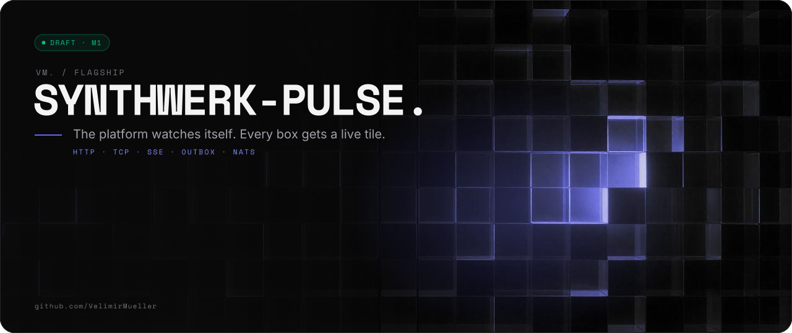
</picture>
</p>

<p>
<picture>
  <source media="(prefers-color-scheme: light)" srcset="assets/readme/lead-v2-light.svg">
  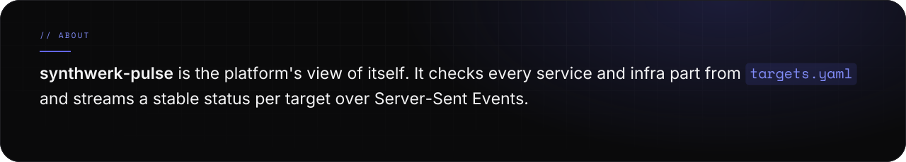
</picture>
</p>

<p>
<picture>
  <source media="(prefers-color-scheme: light)" srcset="assets/readme/stats-v2-light.svg">
  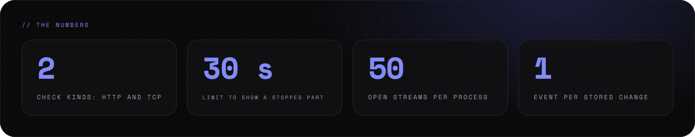
</picture>
</p>

<br>

<p>
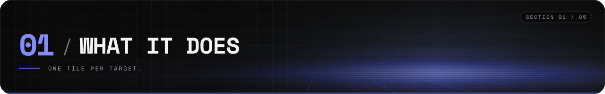
</p>

<p>
<picture>
  <source media="(prefers-color-scheme: light)" srcset="assets/readme/features-v2-light.svg">
  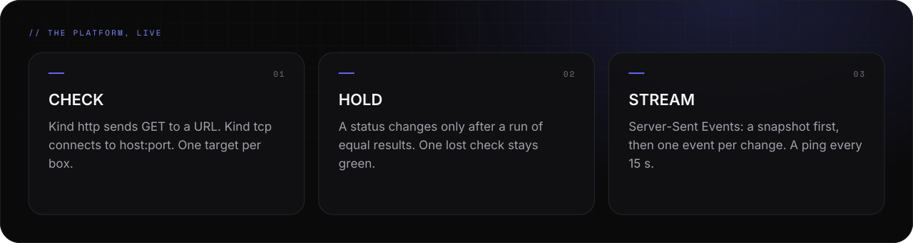
</picture>
</p>

<p>
<picture>
  <source media="(prefers-color-scheme: light)" srcset="assets/readme/what-v2-light.svg">
  
</picture>
</p>

<br>

<p>
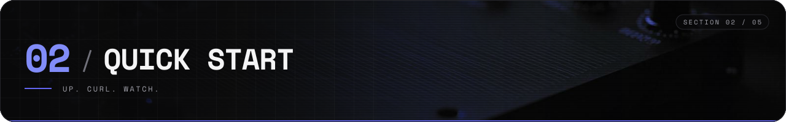
</p>

<p>
<picture>
  <source media="(prefers-color-scheme: light)" srcset="assets/readme/start-v2-light.svg">
  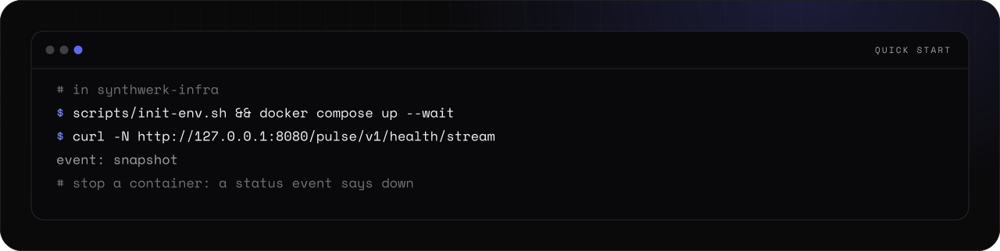
</picture>
</p>

<p>
<picture>
  <source media="(prefers-color-scheme: light)" srcset="assets/readme/setup-v2-light.svg">
  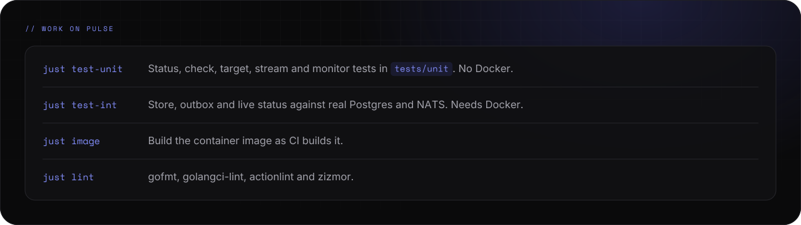
</picture>
</p>

<p>
<picture>
  <source media="(prefers-color-scheme: light)" srcset="assets/readme/startnotes-v2-light.svg">
  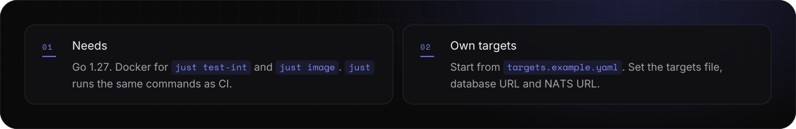
</picture>
</p>

<details>
<summary><picture><source media="(prefers-color-scheme: light)" srcset="assets/readme/links-7-v2-light.svg"></picture></summary>

```bash
# in synthwerk-infra
scripts/init-env.sh && docker compose up --wait
curl -N http://127.0.0.1:8080/pulse/v1/health/stream

# in synthwerk-pulse
just test-unit    # unit tests, no Docker
just test-int     # Postgres + NATS, needs Docker
just image        # container image as CI builds it
```

</details>

<p align="center">
<a href="docs/features/live-status.md"><picture><source media="(prefers-color-scheme: light)" srcset="assets/readme/links-1-v2-light.svg">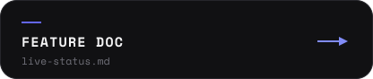</picture></a>
<a href="targets.example.yaml"><picture><source media="(prefers-color-scheme: light)" srcset="assets/readme/links-2-v2-light.svg">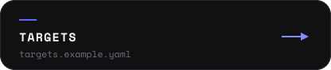</picture></a>
<a href="https://github.com/VelimirMueller/synthwerk/issues/26"><picture><source media="(prefers-color-scheme: light)" srcset="assets/readme/links-3-v2-light.svg">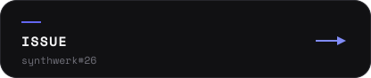</picture></a>
</p>

<br>

<p>
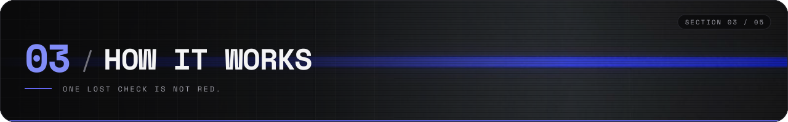
</p>

<p>
<picture>
  <source media="(prefers-color-scheme: light)" srcset="assets/readme/flow-v2-light.svg">
  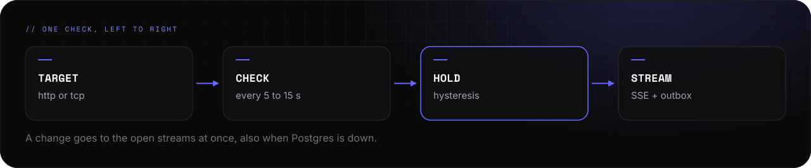
</picture>
</p>

<p>
<picture>
  <source media="(prefers-color-scheme: light)" srcset="assets/readme/how-v2-light.svg">
  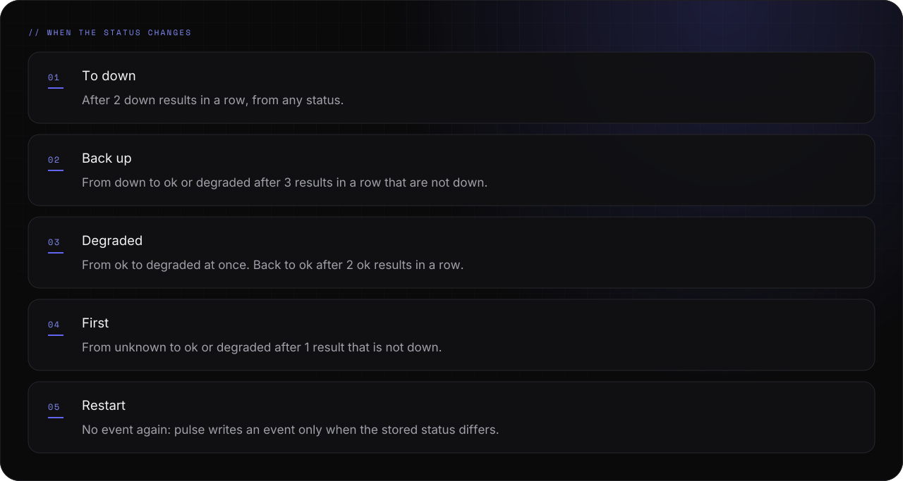
</picture>
</p>

<br>

<p>
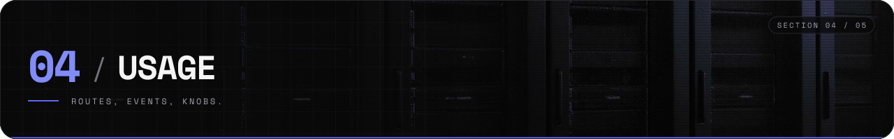
</p>

<p>
<picture>
  <source media="(prefers-color-scheme: light)" srcset="assets/readme/api-v2-light.svg">
  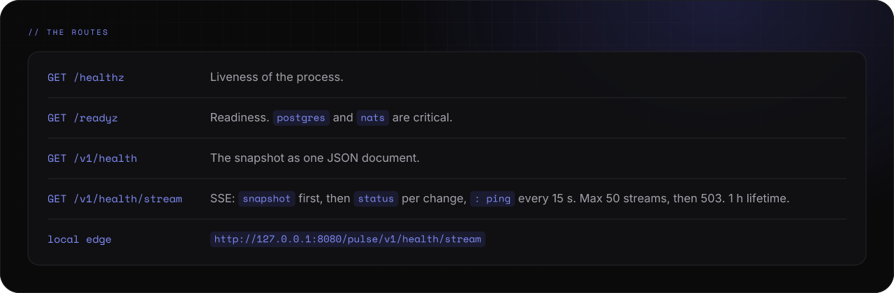
</picture>
</p>

<p>
<picture>
  <source media="(prefers-color-scheme: light)" srcset="assets/readme/events-v2-light.svg">
  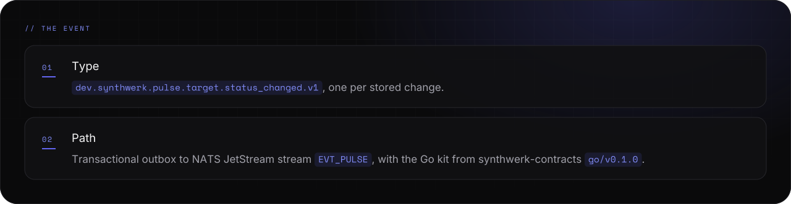
</picture>
</p>

<p>
<picture>
  <source media="(prefers-color-scheme: light)" srcset="assets/readme/config-v2-light.svg">
  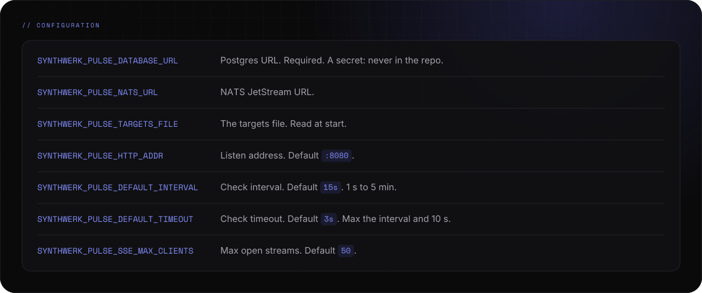
</picture>
</p>

<p>
<picture>
  <source media="(prefers-color-scheme: light)" srcset="assets/readme/config2-v2-light.svg">
  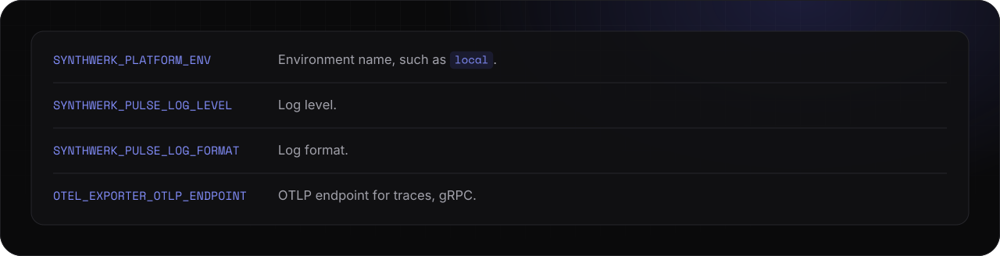
</picture>
</p>

<p align="center">
<a href="https://github.com/VelimirMueller/synthwerk-contracts"><picture><source media="(prefers-color-scheme: light)" srcset="assets/readme/links-4-v2-light.svg">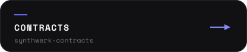</picture></a>
<a href="https://github.com/VelimirMueller/synthwerk-infra"><picture><source media="(prefers-color-scheme: light)" srcset="assets/readme/links-5-v2-light.svg"></picture></a>
<a href="https://github.com/VelimirMueller/synthwerk"><picture><source media="(prefers-color-scheme: light)" srcset="assets/readme/links-6-v2-light.svg">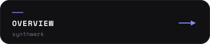</picture></a>
</p>

<br>

<p>
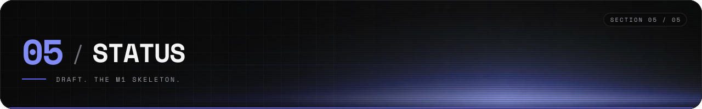
</p>

<p>
<picture>
  <source media="(prefers-color-scheme: light)" srcset="assets/readme/status-v2-light.svg">
  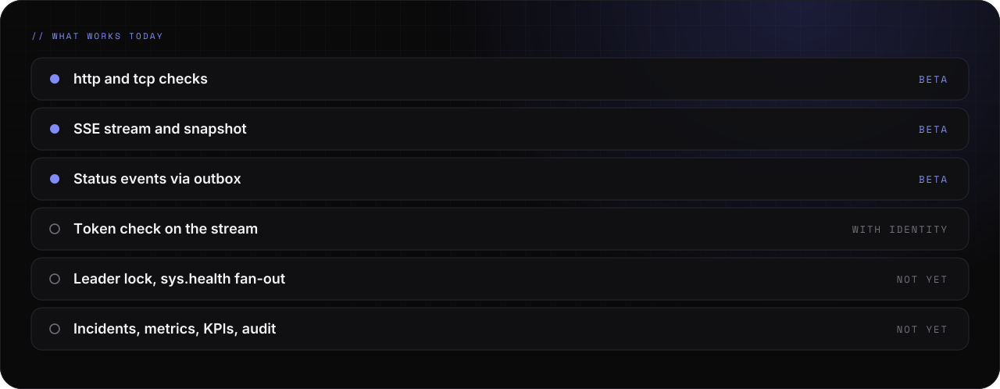
</picture>
</p>

<p>
<picture>
  <source media="(prefers-color-scheme: light)" srcset="assets/readme/now-v2-light.svg">
  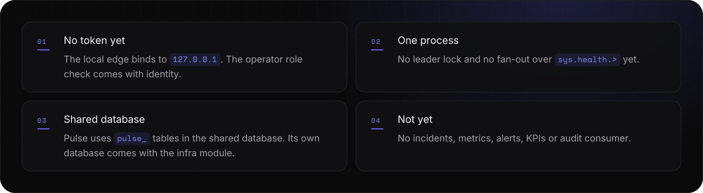
</picture>
</p>

<p>
<picture>
  <source media="(prefers-color-scheme: light)" srcset="assets/readme/checks-v2-light.svg">
  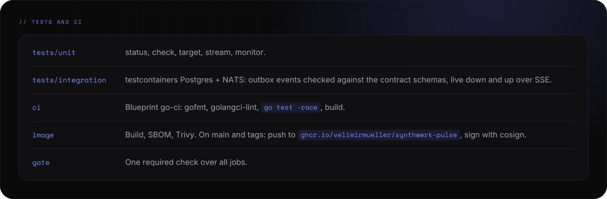
</picture>
</p>

<details>
<summary><picture><source media="(prefers-color-scheme: light)" srcset="assets/readme/links-7-v2-light.svg"></picture></summary>

```bash
just lint         # gofmt, golangci-lint, actionlint, zizmor
just test-unit    # go test -race ./tests/unit/...
just test-int     # go test -tags integration -race ./tests/integration/...
```

</details>

<p>
<picture>
  <source media="(prefers-color-scheme: light)" srcset="assets/readme/footer-v2-light.svg">
  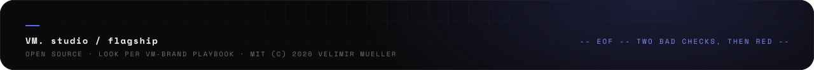
</picture>
</p>
